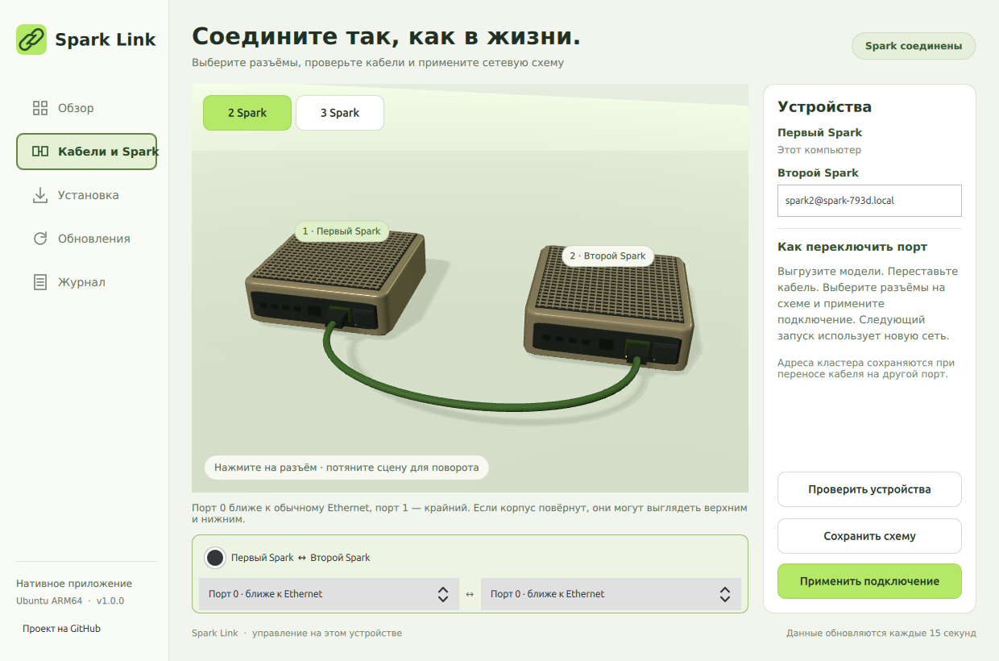

# Spark Link native desktop app

An independently installable Qt Quick / Qt Quick 3D app for Ubuntu 24.04+ ARM64 on the primary NVIDIA DGX Spark. It bundles its own management engine and Qt runtime; the CLI does not need to be installed. The CLI also works without the app. They manage the same Studio/RPC installation, so do not run simultaneous installation/update jobs.



## Download and install

Run on the primary Spark:

```bash
curl -fsSL https://raw.githubusercontent.com/grosa787/connect-dual-spark-for-unsloth-studio/main/desktop/install-desktop.sh | bash
```

The installer downloads and checks the release archive, extracts it, creates an isolated runtime, adds **Spark Link** to the application menu and creates a trusted desktop shortcut. Missing Ubuntu libraries are installed with apt and may require sudo authentication. Private SSH keys remain in their original location.

For a manually downloaded self-extracting installer:

```bash
bash "$HOME/Downloads/Spark-Link-1.1.0-arm64.run"
```

For a manually downloaded tar.gz archive:

```bash
curl -fsSL https://raw.githubusercontent.com/grosa787/connect-dual-spark-for-unsloth-studio/main/desktop/install-desktop.sh | bash -s -- --archive "$HOME/Downloads/Spark-Link-1.1.0-arm64.tar.gz"
```

Alternatively extract the archive in a file manager, open a terminal inside **Spark-Link** and run `bash ./install.sh`. Both formats install the same native app. No manual chmod or `.deb` extraction is required. These commands target Ubuntu ARM64 Spark devices, not macOS/Windows or arbitrary Linux architectures. Qt wheels are included; an extracted release installs without downloading Python packages when the required system libraries are already present.

## Features

Version 1.1 adds independent upright/flat 3D orientation per device, Russian/English/German/Spanish UI, cable-neighbor discovery and native SSH onboarding, and a model memory planner. The release wheels target Ubuntu 24.04 ARM64 with Python 3.12.

- **Overview:** live SSH/device/memory/model state and Studio shortcut.
- **Cables and Spark:** native, rotatable 3D chassis and physical cable meshes, selectable QSFP connectors, keyboard-accessible selectors, two-device or three-device triangle topology.
- **Installation:** bundled independent installation of Unsloth, build prerequisites and version-matched RPC.
- **Updates:** official Studio updater, compatible host/worker rebuild, RPC service startup and app update.
- **Journal:** real command output and persistent logs under `~/.local/state/spark-link`.
- **Model memory:** Hugging Face ID/HTTPS URL or local GGUF, quantization/shard metadata, declared context ceiling, known-architecture KV estimates or an explicit unknown/manual budget, automatic primary-biased reserves and editable percentages/GiB. Plans bind to a specific model variant and apply at its next launch. Layer boundaries make allocations approximate; launch-time free-memory validation runs again.

New cable-connected Sparks are discovered over ConnectX-7 neighbors. After the OS and SSH server have been prepared, the app displays the candidate and SSH fingerprint, asks for its account login/password, pins its host key, infers cabling and installs dependencies/RPC. No manual IP entry is required. Initial software downloads need internet. Active models defer configuration. Hardware validation of a third Spark remains pending.

Closing the window hides it; RPC is an independent system service. Hidden rendering resources are released and state polling slows. Login autostart runs the app in the background; the installer requests user linger for Studio boot startup. Existing local services/models work without internet. Settings use atomic writes, fsync and previous-valid backups. Studio updates save a local runtime/database snapshot for interrupted-update rollback. Snapshots require disk space and are not disk-failure backups.

Account passwords use the encrypted GNOME Secret Service keyring, with no plaintext fallback. Protect and unlock the login keyring; background recovery defers administrative work when it is locked. Autonomous SSH uses a dedicated conventional OpenSSH private key with mode 0600 and no passphrase. Credentials are not placed in process arguments/logs. Loss of a cable/power during inference can terminate the active process: restore connectivity and launch again. Live KV state is not persisted. No physical power-cut test has been performed.

To relocate a cable, unload all models, move the cable, select the actual connector at both endpoints, then apply the connection. Physical port 0 is nearest RJ45; port 1 is the outer QSFP connector when viewed from the back. A rotated enclosure can make these appear upper/lower. The app configures both logical rails for each physical port. It only edits ConnectX-7 configuration and preserves the management interface. Active models, missing SSH hosts, occupied ports, or missing physical carrier block changes. Netplan backups and transaction rollback are included.

The three-device path builds compatible worker runtimes and uses the available configured workers at the next model launch. Disconnecting the third device while idle permits the remaining pair; it does not migrate an already running model. **Three-device mode is experimental:** topology/launcher behavior is covered by tests, but only the available two-device hardware pair was verified. The third device must be qualified after it is connected. The existing two-device custom launcher and model placement are preserved until three-device runtime setup is explicitly performed.

## CLI-only installation

```bash
curl -fsSL https://raw.githubusercontent.com/grosa787/connect-dual-spark-for-unsloth-studio/main/desktop/install-cli.sh | bash
```

Manual package installation uses apt, not an archive manager:

```bash
sudo apt install "$HOME/Downloads/connect-dual-spark_0.6.0_arm64.deb"
connect-dual-spark install
connect-dual-spark check
connect-dual-spark status
connect-dual-spark start-rpc
connect-dual-spark studio
connect-dual-spark refresh
connect-dual-spark update-unsloth
```

CLI 0.6.0 supports two devices. The new three-device topology belongs to the app. Reinstalling the legacy CLI guard can replace a customized launcher; use the app's Updates tab for an existing customized setup.

## Build

```bash
python3 -m pip download --only-binary=:all: --platform manylinux_2_39_aarch64 --python-version 312 --implementation cp --abi abi3 --abi cp312 --dest /tmp/spark-link-wheels PySide6==6.8.3 SecretStorage==3.3.3 cryptography==46.0.3 cffi==2.0.0 jeepney==0.9.0 pycparser==2.23
python3 scripts/build_desktop.py --wheels /tmp/spark-link-wheels
PYTHONPATH=desktop python3 -m unittest discover -s desktop/tests -v
```

The desktop app is GPL-3.0-or-later; bundled `dual_spark` remains MIT. See [third-party notices](THIRD_PARTY_NOTICES.md), [Russian instructions](README.ru.md), and [the main CLI documentation](../README.md).
