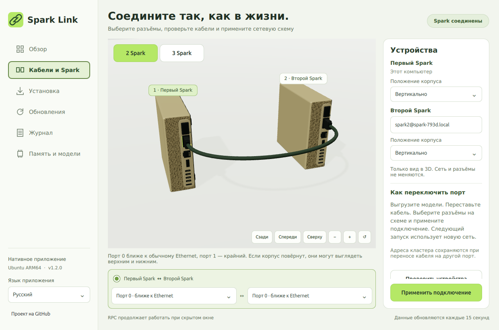
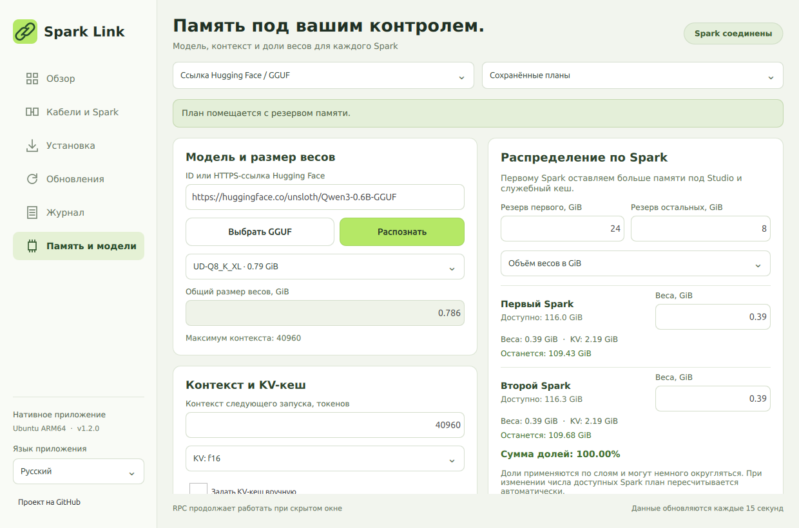

[English](README.md) | **Русский** · [Главная страница проекта](../README.ru.md)

# Spark Link — нативное приложение для DGX Spark

Отдельное Qt Quick приложение для **Ubuntu 24.04+ ARM64 на первом DGX Spark**. В архиве находятся интерфейс, Qt / PySide6 6.8.3 и собственная копия управляющего движка. Устанавливать CLI-пакет Connect Dual Spark для работы приложения не требуется. CLI также работает без приложения. Оба управляют одной установленной Studio и RPC-службой; не запускайте две установки/обновления одновременно.

[Проверенное обновление среды: Unsloth 2026.10.11, llama.cpp b11985, текст и изображения на Q8 через два Spark](../docs/runtime-update-2026-10-31.ru.md).

Spark Link 1.2.0 получил новую модель DGX Spark с реальными пропорциями корпуса, пористыми панелями, утопленными разъёмами, передними ручками и кабелями, которые поворачиваются вместе с корпусом. Добавлены ракурсы камеры, масштаб и единый стиль полей ввода. Версия также включает общее ускорение RPC-загрузки и безопасно обновляет независимые управляющие файлы fastload, сохраняя пользовательские правила запуска. [Отчёт о скорости и пределе памяти Mistral](../docs/startup-and-mistral-2026-10-31.ru.md).



[Новый корпус и измеренные эксперименты с генерацией](../docs/design-and-generation-2026-10-31.ru.md).

## Язык интерфейса

Здесь документация и скриншоты на русском. Выберите [English](README.md), чтобы открыть английскую инструкцию с английскими скриншотами.

В приложении откройте список **Язык приложения** внизу левой панели и выберите **Русский** или **English**. Вкладки, кнопки, состояния и диалоги переключаются сразу. Выбор сохраняется для следующих запусков. Также доступны немецкий и испанский. Язык документации на GitHub и сохранённый язык установленного приложения выбираются отдельно.

| Документация и скриншоты | Выбор языка в приложении |
| --- | --- |
| [Русский](README.ru.md) | Русский |
| [English](README.md) | English |

## Скачать и установить одной командой

Откройте терминал **на первом Spark**:

```bash
curl -fsSL https://raw.githubusercontent.com/grosa787/connect-dual-spark-for-unsloth-studio/main/desktop/install-desktop.sh | bash
```

Команда скачивает архив из релиза GitHub, проверяет SHA-256, распаковывает его, устанавливает изолированный runtime в `~/.local/share/spark-link`, создаёт команду `~/.local/bin/spark-link`, пункт **Spark Link** в меню приложений и доверенный ярлык на рабочем столе. Системные библиотеки устанавливаются через apt только если отсутствуют; тогда потребуется пароль sudo. Приватные SSH-ключи никуда не копируются.

После установки найдите **Spark Link** в меню по клавише Super или откройте ярлык **Spark Link** на рабочем столе.

## Скачали файл вручную

Самый простой вариант — [Spark-Link-1.2.0-arm64.run](https://github.com/grosa787/connect-dual-spark-for-unsloth-studio/releases/download/desktop-v1.2.0/Spark-Link-1.2.0-arm64.run). После скачивания выполните:

```bash
bash "$HOME/Downloads/Spark-Link-1.2.0-arm64.run"
```

Если браузер сохраняет в «Загрузки», замените `Downloads` на фактический каталог. `chmod` и ручная распаковка не нужны. Установщик сам добавит приложение в меню.

Для отдельно скачанного [tar.gz-архива](https://github.com/grosa787/connect-dual-spark-for-unsloth-studio/releases/download/desktop-v1.2.0/Spark-Link-1.2.0-arm64.tar.gz) используйте:

```bash
curl -fsSL https://raw.githubusercontent.com/grosa787/connect-dual-spark-for-unsloth-studio/main/desktop/install-desktop.sh | bash -s -- --archive "$HOME/Downloads/Spark-Link-1.2.0-arm64.tar.gz"
```

Или распакуйте архив обычным архиватором, откройте терминал в полученной папке **Spark-Link** и выполните:

```bash
bash ./install.sh
```

Эти команды предназначены для Spark с Ubuntu ARM64, а не для macOS/Windows или произвольной архитектуры. Qt уже входит в релиз; при наличии системных библиотек установка скачанного архива работает без загрузки Python-пакетов из интернета.

## Вкладки

- **Обзор** — фактическая доступность Spark, свободная память, активная модель, открытие Studio и проверка RPC.
- **Кабели и Spark** — объёмные модели золотого корпуса, разъёмы и кабели, поворот сцены мышью, выбор портов мышью или клавиатурой, SSH-имена устройств.
- **Установка** — установка Unsloth, недостающих системных инструментов и согласованного RPC. Существующие пользовательские правила размещения моделей сохраняются.
- **Обновления** — официальный updater Studio, согласование host/worker, запуск службы RPC и обновление самого приложения.
- **Журнал** — реальный вывод последней операции; все журналы доступны в `~/.local/state/spark-link`.

При открытии приложение проверяет состояние и восстанавливает доступные локальные службы. Во время работы модели можно смотреть диагностику и схему. Установка, обновление RPC и изменение сети проверяют отсутствие активной модели повторно перед выполнением. Для каждого корпуса можно выбрать горизонтальное или вертикальное положение в 3D. Языки интерфейса: русский, английский, немецкий и испанский; выбор сохраняется.

## Перенос кабеля в другой порт

1. Выгрузите модели в Studio на всех затрагиваемых Spark.
2. Физически переставьте кабель.
3. Откройте **Кабели и Spark**, выберите соответствующий разъём на обоих концах кабеля.
4. Нажмите **Применить подключение**. Для административных операций приложение покажет собственное окно пароля; терминал не нужен.
5. Дождитесь результата проверки, затем запускайте модель обычным способом.

Порт **0** — QSFP ближе к обычному Ethernet/RJ45; порт **1** — крайний QSFP, если смотреть сзади. При повёрнутом корпусе они выглядят верхним/нижним. Привязывайте выбор к RJ45, а не к словам «верх/низ». Один физический QSFP отображается в Linux как два интерфейса, поэтому приложение настраивает обе линии.

Приложение изменяет только четыре интерфейса ConnectX-7. Обычная управляющая сеть не затрагивается. Прежний netplan сохраняется в `/etc/netplan/.spark-link-backups`. При неудачном применении выполняется откат. Если выбранный разъём не имеет физического линка или какой-либо Spark недоступен по SSH, применение блокируется. Изменение изображения или сохранение черновика само по себе сеть не меняет.

## Третий Spark

После первоначальной настройки Ubuntu на новом Spark включите SSH и подключите ConnectX-7. Приложение ищет соседей через кабель, показывает найденный Spark и отпечаток SSH-ключа. Нажмите **Добавить**, введите логин и пароль его учётной записи. IP-адрес и SSH-конфиг вручную вводить не требуется. Приложение проверит GB10, закрепит ключ устройства, определит кабели и начнёт установку зависимостей и RPC. Для первой установки ПО нужен интернет. Изменения ждут выгрузки активных моделей. Если настройка прервётся, её можно повторить. Для трёх устройств требуются три кабеля треугольника; каждый физический порт участвует только в одном кабеле. Ручная схема также доступна.

Для трёх устройств применяется отдельный launcher приложения. Он использует доступные настроенные workers на момент запуска модели. Если третий Spark отключён при выгруженных моделях, следующий запуск работает на оставшейся паре. Без workers разрешается локальный запуск модели, которая помещается в память первого Spark. Перераспределения уже запущенной модели при выдёргивании кабеля нет.

**Трёхузловой режим экспериментальный:** топология, команды запуска и переход к двум workers покрыты тестами; физически проверена только имеющаяся пара Spark. Полный запуск на трёх устройствах требует проверки после подключения третьего. Не отображается фиктивный «подключённый» третий Spark.

## Память модели



Во вкладке **Память модели** вставьте ID или HTTPS-ссылку Hugging Face либо выберите локальный GGUF. Приложение определит варианты квантования, размер всех частей, архитектуру и заявленный моделью предел контекста. Это предел из метаданных, а не обещание, что контекст поместится в память.

Автораспределение оставляет по умолчанию 24 GiB на первом Spark и 8 GiB на каждом worker, плюс 4 GiB вычислительного резерва на устройство. Можно задать доли в процентах или GiB. Они превращаются в `tensor-split`, поэтому фактическая доля приблизительна из-за границ слоёв. KV-кэш уже распределяется вместе со слоями; дополнительные CPU/prompt-буферы на первом Spark требуют большего резерва. Оценка KV для непонятных сжатых/гибридных архитектур остаётся неизвестной: используйте измерение из журнала или явный бюджет. Сохранённый план применяется только при следующем запуске соответствующего GGUF. Перед запуском проверяется доступная память заново; приложение не переносит активную модель между устройствами.

## Отключения и восстановление

Закрытие окна скрывает интерфейс. RPC работает отдельной системной службой; при скрытии частота проверок уменьшается, графические ресурсы освобождаются. Приложение запускается в фоне при входе пользователя; это можно отключить в интерфейсе. Установщик включает linger для запуска пользовательских служб Studio при загрузке, если система разрешает это.

Настройки и пути записываются атомарно с `fsync` и резервной `.bak`-копией. Пароли учётных записей хранятся только через зашифрованный GNOME Keyring, без открытого текстового резервного файла. Хранилище должно быть защищено паролем и разблокировано пользовательским сеансом. При заблокированном хранилище фоновое восстановление не запрашивает пароль; откройте приложение для административной операции. SSH-доступ использует отдельный стандартный OpenSSH-ключ с правами `0600`; ключ не шифруется паролем, чтобы SSH работал автономно. Пароли не передаются в аргументах процессов или журналах. Первый вход на новом устройстве всё равно требует авторизации.

При запуске приложение сверяет локальные настройки, маршруты и службы; недоступный Spark остаётся в сохранённой схеме. Уже установленные модели/службы не требуют интернета. Перед обновлением Studio создаётся локальная копия runtime и баз данных; незавершённое обновление можно откатить без загрузки пакетов. Эти копии находятся в `~/.local/state/spark-link/update-backups` и требуют свободного диска. Это восстановление ПО, а не резервная копия от поломки накопителя.

Если кабель или питание пропали во время генерации, текущий процесс может завершиться: после возвращения устройств модель нужно запустить заново. KV-кэш текущей генерации не сохраняется на диск. Сохранённые настройки, модели на диске и пароли остаются. Физическое отключение питания и работа с третьим устройством ещё не проверены на железе.

## CLI без графического приложения

Скачать CLI, установить `.deb` через apt и добавить его ярлык:

```bash
curl -fsSL https://raw.githubusercontent.com/grosa787/connect-dual-spark-for-unsloth-studio/main/desktop/install-cli.sh | bash
```

Для `.deb`, скачанного вручную:

```bash
sudo apt install "$HOME/Downloads/connect-dual-spark_0.6.1_arm64.deb"
connect-dual-spark --lang ru install
```

`.deb` не нужно вручную разархивировать: `apt install /путь/к/файлу.deb` устанавливает пакет и зависимости.

```bash
connect-dual-spark --lang ru check
connect-dual-spark --lang ru status
connect-dual-spark --lang ru start-rpc
connect-dual-spark --lang ru studio
connect-dual-spark --lang ru refresh
connect-dual-spark --lang ru update-unsloth
```

CLI 0.6.1 рассчитана на два Spark. Новая графическая схема трёх устройств живёт в приложении. Переустановка старой CLI-настройки может заменить пользовательский launcher; для обновления уже настроенной пользовательской установки используйте вкладку **Обновления** приложения.

## Сборка из исходников

```bash
python3 -m pip download --only-binary=:all: --platform manylinux_2_39_aarch64 --python-version 312 --implementation cp --abi abi3 --abi cp312 --dest /tmp/spark-link-wheels PySide6==6.8.3 SecretStorage==3.3.3 cryptography==46.0.3 cffi==2.0.0 jeepney==0.9.0 pycparser==2.23
python3 scripts/build_desktop.py --wheels /tmp/spark-link-wheels
PYTHONPATH=desktop python3 -m unittest discover -s desktop/tests -v
```

На Spark с установленным PySide6 для проверки настоящего Qt-интерфейса:

```bash
cd desktop
xvfb-run -a -s '-screen 0 1440x1000x24' env QSG_RHI_BACKEND=opengl QT_QUICK_CONTROLS_STYLE=Basic python3 qa_native.py
```

Нативный интерфейс лицензирован GPL-3.0-or-later; движок `dual_spark` остаётся MIT. [Проверки и ограничения](TESTING.ru.md). Информация о Qt и исходниках — в [THIRD_PARTY_NOTICES.md](THIRD_PARTY_NOTICES.md).
