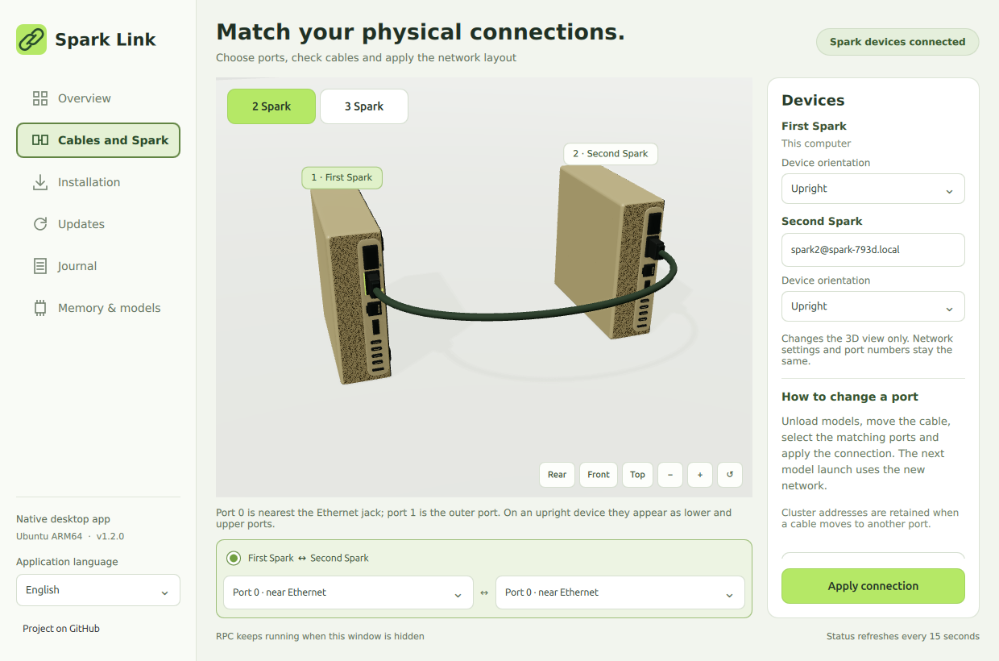

**English** | [Русский](design-and-generation-2026-10-31.ru.md)

# Spark Link 1.2: hardware scene and generation study

The native app now depicts the DGX Spark's 150 × 150 × 50.5 mm form, smooth champagne lid, porous front/rear faces, front grips, rubber feet and recessed rear I/O. Physical port 0 remains nearest Ethernet; port 1 remains the outer QSFP. The illustration is original procedural geometry, not NVIDIA CAD. [Hardware reference](https://docs.nvidia.com/dgx/dgx-spark/hardware.html).

The scene offers rear/front/top camera presets, drag rotation, wheel/button zoom and reset. Independent upright/flat placement rotates the plugs and cable anchors together. Navigation is wider; fields, selectors and radio controls share the lime palette. Device cards support mouse/keyboard selection. Discovery results are reconciled with current inventory, preventing a delayed scan from offering an already connected worker again.

Qt 6.8 lost static custom meshes after complete scene-graph teardown. The app now retains the graph nodes while still allowing the graphics context and cheap caches to be released on hide. Reopening is checked visually; retaining these nodes costs some RAM compared with the older aggressive teardown. Visual QA explicitly checks that gold chassis pixels exist before and after hide/show, in addition to checking QML errors and control actions.



## Generation, separately from startup

Measured on the existing two GB10 Spark systems, using the same installed llama.cpp source `6f4cc4d72556554a7c137de536e2fbd93fd7f907` and matched RPC build. No main model weights, quantization, reasoning setting or KV precision were changed between runs.

- Model: `unsloth/Mistral-Large-4-1T-A52B-GGUF`, snapshot `1eb4373d37e76f6e7b4b8efa20e1b1ca40b3b964`, existing **UD-IQ1_S** six-shard model. These are Mistral measurements, not Q8 DeepSeek measurements.
- Context 4096, one slot, F16 K/V, Flash Attention on, all layers offloaded, layer split 46:54, batch 128 / microbatch 64. Same binary, prompts, seed 1234, temperatures 0 and 0.7.
- Three prompts: Python interval merging, a Russian rope puzzle, JavaScript-to-TypeScript rewriting. Each request generates 128 tokens with prompt reuse disabled and EOS ignored for a fixed-length throughput comparison. Six short throughput requests per configuration; not an accuracy benchmark or a long-context qualification.
- DSpark adds the publisher's compatible Q8 draft, SHA-256 `e28eb475d307d9541842bfc2c15db3d19af16638b98228234824e2560a03e65f`, 2,245,605,984 bytes. Its maximum draft length is 3.

| Request | Ordinary, tokens/s | DSpark, tokens/s | Speed ratio |
| --- | ---: | ---: | ---: |
| Code, T=0 | 6.90 | 12.76 | 1.85× |
| Reasoning, T=0 | 6.94 | 9.44 | 1.36× |
| Rewrite, T=0 | 7.12 | 9.96 | 1.40× |
| Code, T=0.7 | 7.21 | 11.25 | 1.56× |
| Reasoning, T=0.7 | 7.14 | 8.62 | 1.21× |
| Rewrite, T=0.7 | 7.11 | 11.51 | 1.62× |
| **Median throughput** | **7.12** | **10.61** | **1.49×** |

`ngram-map-k` produced a median of 7.06 tokens/s: no useful improvement in this suite. It is not enabled by default. Minimum available RAM during successful DSpark testing was 5.09 / 3.31 GiB; measured swap growth was zero on both nodes. Existing swap usage was not cleared.

DSpark's first attempt with `--spec-draft-device CUDA0` aborted during draft graph setup: the shared `output.weight` was allocated on RPC0, absent from the draft's devices. Giving the draft access to **CUDA0,RPC0** resolved this without changing or rebuilding the engine. Both normal services stayed available after the isolated process exited.

## What is preserved, and what is not proven

Speculative decoding proposes tokens and has the original target model verify them. The installed `common/sampling.cpp::common_sampler_sample_and_accept_n` samples from the target at each position and accepts a proposal only when it matches. DSpark's draft path uses that verifier, including nonzero temperature. This does not replace the original weights with the draft or reduce the target's reasoning budget. [llama.cpp speculative decoding](https://github.com/ggml-org/llama.cpp/blob/master/docs/speculative.md), [publisher's compatible draft and instructions](https://huggingface.co/unsloth/Mistral-Large-4-1T-A52B-GGUF).

The tested speculative runs were **not byte-identical** to the ordinary run: n-gram matched two of three greedy outputs, and DSpark matched none of the six complete output prefixes. Different verification batch shapes can change floating-point results; nonzero-temperature runs are also sensitive to sampling state. We have not established the cause of every output difference. These measurements establish throughput and successful target verification, **not equal quality on every task**. This release therefore leaves speculation **off in normal Studio launches**. Saved model/context/split rules and the Q8 setup are unchanged.

The extra draft is model-specific and consumes memory. This 4096-context test does not validate DSpark at the previous 106496-token Mistral limit, nor at Q8's million-token configuration. No smaller weight/KV quantization, reduced reasoning effort, shortened ordinary context or synthetic acceptance was used to claim a speedup.

## Reproduce the isolated experiment

Run from a checkout on the primary Spark, with models unloaded and a compatible draft already downloaded. Set `model` to the first shard of the existing Mistral model and `draft` to the publisher's DSpark GGUF. Use the account's existing SSH target for read-only worker memory monitoring:

```bash
python3 scripts/benchmark_generation.py --model "$model" --worker-ssh spark2@10.100.32.2 --spec none --label generation-baseline-4096
python3 scripts/benchmark_generation.py --model "$model" --worker-ssh spark2@10.100.32.2 --spec ngram-map-k --label generation-ngram-4096
python3 scripts/benchmark_generation.py --model "$model" --draft "$draft" --worker-ssh spark2@10.100.32.2 --spec draft-dspark --label generation-dspark-pair-4096
```

The script binds to loopback port 59446, refuses an existing primary `llama-server`, monitors both nodes and stops its own isolated process below 1.5 GiB available RAM or after more than 0.5 GiB additional swap. It never edits Studio launch rules or the RPC service. The 46:54 split and workload are specifically qualified for the model above; other models need their own memory plan and compatible draft.

[Machine-readable timings and output hashes](generation-validation-2026-10-31.json). Output hashes are supplied so differences can be audited without publishing raw model reasoning. Previous [startup and maximum-context results](startup-and-mistral-2026-10-31.md) remain separate.

## Native application verification

The 1.2.0 self-extracting release was installed with its bundled isolated Qt runtime on the first Spark. Hidden startup, IPC reopening with visible chassis, hiding again and independent Studio/RPC health passed. RSS in that Xvfb sample was 399.2 MiB initially hidden, 404.9 MiB visible and 401.0 MiB hidden again. This is higher than the previous simpler scene and is not a memory ceiling. Rendering stops while hidden; RPC remains a separate service.
