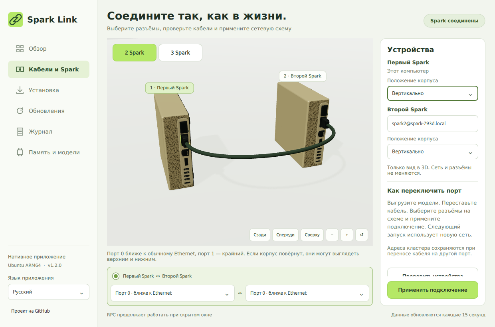

[English](design-and-generation-2026-10-31.md) | **Русский**

# Spark Link 1.2: новый корпус и исследование генерации

Нативное приложение получило модель корпуса DGX Spark с пропорциями 150 × 150 × 50,5 мм, гладкой золотистой крышкой, пористыми передней и задней панелями, передними ручками, резиновыми ножками и утопленными разъёмами. Порт 0 по-прежнему ближе к Ethernet, порт 1 — крайний QSFP. Это собственная процедурная иллюстрация, а не CAD NVIDIA. [Официальное описание оборудования](https://docs.nvidia.com/dgx/dgx-spark/hardware.html).

Добавлены ракурсы сзади, спереди и сверху, поворот мышью, масштаб колёсиком и кнопками, сброс камеры. Корпуса можно независимо ставить вертикально: штекеры и точки подключения кабеля поворачиваются вместе с ними. Расширена навигация, поля, списки и переключатели приведены к единому салатовому стилю. Карточки устройств выбираются мышью и клавиатурой. Запоздавший результат поиска сверяется с текущими устройствами и больше не должен предлагать уже подключённый второй Spark как новый.

Qt 6.8 терял статические 3D-сетки после полного удаления графа сцены. Теперь приложение сохраняет узлы сцены, но по-прежнему разрешает освобождение графического контекста и недорогих кэшей при скрытии. Повторное открытие проверяется визуально; сохранение узлов требует немного больше памяти, чем прежнее полное удаление сцены. Визуальная проверка теперь проверяет наличие самих корпусов до и после скрытия окна, а не только отсутствие ошибок QML.



## Скорость генерации, отдельно от запуска

Замеры сделаны на наших двух Spark GB10, на прежней сборке llama.cpp из исходников `6f4cc4d72556554a7c137de536e2fbd93fd7f907` и согласованном RPC. Между прогонами не менялись основные веса, квантование, настройка рассуждений и точность KV.

- Модель: `unsloth/Mistral-Large-4-1T-A52B-GGUF`, снимок `1eb4373d37e76f6e7b4b8efa20e1b1ca40b3b964`, уже скачанная **UD-IQ1_S**, шесть частей. Это замеры Mistral, а не DeepSeek Q8.
- Контекст 4096, один слот, K/V F16, Flash Attention включён, все слои на GPU, разделение по слоям 46:54, batch 128 / microbatch 64. Одинаковые исполняемый файл, запросы, seed 1234 и температуры 0 / 0,7.
- Три запроса: Python-функция слияния интервалов, задача о верёвках на русском и переписывание JavaScript в TypeScript. По 128 генерируемых токенов, повторное использование промпта отключено, EOS игнорируется для сравнения одинаковой длины. Всего шесть коротких запросов на конфигурацию; это проверка скорости, а не полноценная оценка качества или длинного контекста.
- DSpark добавляет совместимый Q8-драфт издателя: SHA-256 `e28eb475d307d9541842bfc2c15db3d19af16638b98228234824e2560a03e65f`, 2 245 605 984 байта. Максимальная длина предложения — три токена.

| Запрос | Обычный режим, ток/с | DSpark, ток/с | Отношение скоростей |
| --- | ---: | ---: | ---: |
| Код, T=0 | 6,90 | 12,76 | 1,85× |
| Рассуждение, T=0 | 6,94 | 9,44 | 1,36× |
| Переписывание, T=0 | 7,12 | 9,96 | 1,40× |
| Код, T=0,7 | 7,21 | 11,25 | 1,56× |
| Рассуждение, T=0,7 | 7,14 | 8,62 | 1,21× |
| Переписывание, T=0,7 | 7,11 | 11,51 | 1,62× |
| **Медианная скорость** | **7,12** | **10,61** | **1,49×** |

Простой `ngram-map-k` дал медиану 7,06 ток/с: полезного выигрыша на этой подборке нет, по умолчанию он выключен. В успешном тесте DSpark минимум доступной памяти составил 5,09 / 3,31 ГиБ, прирост swap — ноль на обоих устройствах. Старое содержимое swap не очищалось.

Первая попытка с `--spec-draft-device CUDA0` остановилась при построении графа драфта: общий `output.weight` находится на RPC0, которого нет в списке устройств драфта. Указание **CUDA0,RPC0** решило проблему без изменения исходников или пересборки движка. После завершения отдельного тестового процесса обычные службы оставались доступны.

## Что сохраняется и что пока не доказано

Спекулятивное декодирование предлагает токены и проверяет их основной моделью. В установленном `common/sampling.cpp::common_sampler_sample_and_accept_n` каждый токен выбирается семплером основной модели; предложение принимается только при совпадении. DSpark использует эту проверку, в том числе при ненулевой температуре. Драфт не подменяет основную модель и не уменьшает её бюджет рассуждений. [Документация llama.cpp](https://github.com/ggml-org/llama.cpp/blob/master/docs/speculative.md), [совместимый драфт и инструкция издателя](https://huggingface.co/unsloth/Mistral-Large-4-1T-A52B-GGUF).

Ответы **не совпали побайтно** с обычным режимом: n-gram совпал в двух из трёх greedy-запросов, DSpark — ни в одном из шести полных префиксов ответа. Другая форма пакетов проверки может менять округления вычислений; при ненулевой температуре результат также зависит от состояния семплера. Причина каждого отдельного расхождения не установлена. Замеры подтверждают скорость и работу проверки основной моделью, **но не доказывают равное качество на любых задачах**. Поэтому в обычном запуске Studio спекуляция в этом выпуске **остаётся выключенной**. Сохранённые правила моделей, контекста, распределения и конфигурация Q8 не менялись.

Драфт подходит конкретной модели и занимает дополнительную память. Тест на 4096 токенов не подтверждает работу DSpark на прежнем пределе Mistral 106496 токенов или в миллионном контексте Q8. Ради ускорения не снижались квантование весов/KV, усилие рассуждений и обычный контекст; синтетическое принятие токенов не использовалось.

## Повторить отдельный эксперимент

Запускайте из копии репозитория на первом Spark, выгрузив модели и предварительно скачав совместимый драфт. Переменная `model` должна указывать на первую часть существующей Mistral, `draft` — на GGUF драфта. Укажите действующий SSH-адрес второго устройства для чтения состояния памяти:

```bash
python3 scripts/benchmark_generation.py --model "$model" --worker-ssh spark2@10.100.32.2 --spec none --label generation-baseline-4096
python3 scripts/benchmark_generation.py --model "$model" --worker-ssh spark2@10.100.32.2 --spec ngram-map-k --label generation-ngram-4096
python3 scripts/benchmark_generation.py --model "$model" --draft "$draft" --worker-ssh spark2@10.100.32.2 --spec draft-dspark --label generation-dspark-pair-4096
```

Скрипт слушает только loopback на порту 59446, отказывается запускаться при существующем `llama-server` на первом Spark, следит за обоими устройствами и завершает только свой процесс при доступной памяти ниже 1,5 ГиБ либо росте swap больше 0,5 ГиБ. Настройки Studio и службы RPC не редактируются. Разделение 46:54 и набор запросов проверены для указанной модели; другим моделям нужны свой план памяти и совместимый драфт.

[Машиночитаемые замеры и хэши ответов](generation-validation-2026-10-31.json). Хэши позволяют проверить расхождения без публикации сырых рассуждений модели. Предыдущие [замеры запуска и максимального контекста](startup-and-mistral-2026-10-31.ru.md) приведены отдельно.

## Проверка установленного приложения

Самораспаковывающийся выпуск 1.2.0 установлен на первый Spark со своим изолированным Qt. Проверены скрытый запуск, повторное открытие через IPC с видимыми корпусами, повторное скрытие и доступность независимых Studio/RPC. В этой Xvfb-сессии RSS составил 399,2 МиБ при скрытом запуске, 404,9 МиБ в открытом окне и 401,0 МиБ после скрытия. Это больше, чем у прежней упрощённой сцены, и не является верхней границей. В скрытом окне рендеринг останавливается; RPC остаётся отдельной службой.
