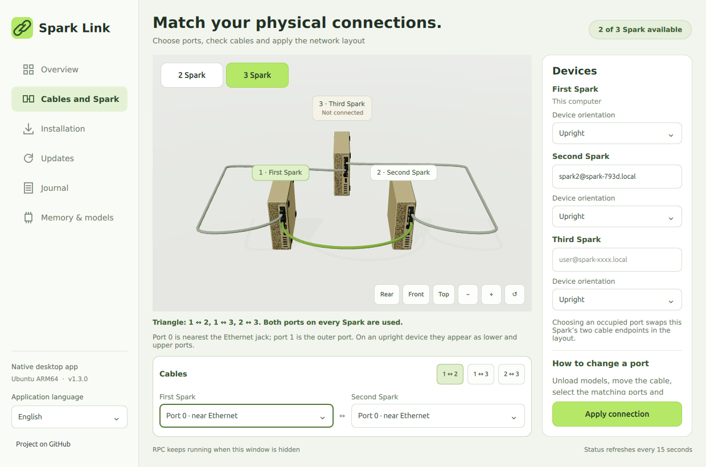

**English** | [Русский](third-spark-2026-10-31.ru.md)

# Third Spark enrollment and real three-GPU validation — Spark Link 1.4.0

The third Spark is now enrolled, provisioned and visible in the native app. All three physical devices form the verified direct triangle:

| Edge | Actual physical ports | Cluster networks |
| --- | --- | --- |
| First ↔ second | 0 ↔ 0 | 10.100.32/24, 10.100.33/24 |
| First ↔ third | 1 ↔ 1 | 10.100.34/24, 10.100.35/24 |
| Second ↔ third | 1 ↔ 0 | 10.100.36/24, 10.100.37/24 |

Port 0 is nearest Ethernet; upper/lower position depends on case orientation. All three case preferences are upright. The incomplete first↔third cable seating was corrected during setup; both physical ports now show carrier.



## Why discovery failed

The previous scanner required an already-addressed ConnectX neighbor visible from the primary Spark. The new device initially had no ConnectX IP and was connected through the second Spark. Its SSH account was also different, and a manually entered bare hostname did not specify that account. Finally, the first and third machines had identical OS `machine-id` values, which could wrongly deduplicate two physical devices.

The new scanner uses passive Spark SSH-service advertisements and LLDP from all reachable enrolled nodes, resolves management addresses first and retains alternative advertised IPv4 addresses. It performs no general subnet sweep. The actual third Spark was offered as an unauthenticated candidate before registration. Login/host-key approval is still required for an unknown device; GB10 hardware and a GPU-derived identity are verified before enrollment.

GPU-derived identities now distinguish cloned OS images. Existing credential IDs are preserved, so older encrypted records remain usable; new devices receive separate encrypted records and pinned host-key aliases. An unverified, offline manually entered placeholder can be replaced with the correctly authenticated device. A down physical port cannot be treated as a healthy triangle merely because its IP address exists.

## Installed and verified

- CUDA 13.0 and the GB10 driver were verified; required build, RDMA and discovery packages were checked/installed. No driver replacement or OS reboot was needed.
- The third worker was built from the same patched source/flags as the existing runtime: llama.cpp source `6f4cc4d72556554a7c137de536e2fbd93fd7f907`, build ID `43e6caad6164ca8ad0d2a1bc6299a92f19c16df00a159781babd58e45dd01871`.
- Workers have independent manifests, shared-library digests and selected releases. RPC runs as the worker account, is enabled at boot and restarts automatically. The third worker restart was tested while models were unloaded; the gateway temporarily listed the remaining pair, then returned to all three devices without reconfiguration.
- Dedicated ConnectX profiles and IP addresses are persistent. MTU 9000 is set on the four logical ConnectX interfaces of every node; management remains at 1500. Thirty-six full-size, nonfragmenting IPv4 echo packets passed across all three edges, both rails and both directions, with zero loss. RDMA used MTU 4096 on both primary links.
- Administrator credentials are stored in the encrypted GNOME keyring under separate device identities. Passwords and private keys are not in the repository or report. Only public-key enrollment was performed on the new worker.
- The independently usable model gateway now selects available configured RPC workers. The original two-device delegate is preserved for audit/rollback. Model weights and KV precision were not altered.

## Real Studio inference

The existing `unsloth/DeepSeek-V4-Flash-Vision-Exp-GGUF` **UD-Q8_K_XL** was loaded through the Studio API with configured context **1048576**, four slots and F16 KV. It selected **CUDA0 + RPC0 + RPC1**, requested layer proportions **28:36:36**, and used both physical primary links over RDMA. Observed readiness was 105.6 seconds; this is one functional check, not a controlled speed comparison.

| Device | Weight buffers, MiB | KV buffers, MiB |
| --- | ---: | ---: |
| Primary CUDA0 | 46042.78 | 7879 |
| Second Spark, 10.100.32.2 | 56694.83 | 10544 |
| Third Spark, 10.100.34.2 | 50618.24 | 9226 |

Layer granularity makes actual allocations differ from the requested percentages. Logs label both remote backend buffers `RPC0[endpoint]`; verification distinguishes endpoints rather than summing them under the global RPC index.

The text fixture returned **4** and the synthetic solid-red image returned **Red**. The model was unloaded afterward. The full million-token input window was not filled by this smoke test; the context allocation was checked. Studio remained HTTP 200, both worker services active and boot-enabled.

## Application and release

138 CLI tests and all 58 desktop checks passed across the Qt/system Python runtimes. Real ARM64 Qt rendering covered three live inventories, distinct hardware IDs despite duplicate OS IDs, six tabs/four languages, upright cases, compact layout and hide/show. Installed background startup and IPC reopening passed; measured RSS was about 437–440 MiB in the Xvfb sample, not a ceiling.

Install on the first Spark:

```bash
curl -fsSL https://raw.githubusercontent.com/grosa787/connect-dual-spark-for-unsloth-studio/main/desktop/install-desktop.sh | bash
```

Manual download: `bash "$HOME/Downloads/Spark-Link-1.4.0-arm64.run"`. Both installers include the isolated runtime and menu/desktop integration. [Full instructions](../desktop/README.md).

Physical power-cut recovery and moving every possible port permutation were not tested. A running distributed model does not survive losing a required worker. The validated idle worker restart is distinct from hot model migration.

Post-install cache qualification: the third-worker host client was compiled into its independent final cache path, with local library RUNPATH and a current manifest. With the second RPC temporarily stopped while idle, the gateway selected the primary+third pair through that client; after automatic restart it returned to all three. This also prevents later pruning of the first pair’s old cache from breaking the alternate pair.
