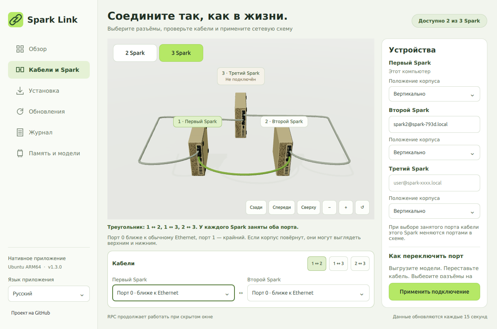

[English](third-spark-2026-10-31.md) | **Русский**

# Добавление третьего Spark и проверка трёх GPU — Spark Link 1.4.0

Третий Spark зарегистрирован, настроен и отображается в нативном приложении. Проверен настоящий треугольник:

| Соединение | Фактические физические порты | Сети кластера |
| --- | --- | --- |
| Первый ↔ второй | 0 ↔ 0 | 10.100.32/24, 10.100.33/24 |
| Первый ↔ третий | 1 ↔ 1 | 10.100.34/24, 10.100.35/24 |
| Второй ↔ третий | 1 ↔ 0 | 10.100.36/24, 10.100.37/24 |

Порт 0 ближе к Ethernet; верхнее/нижнее положение зависит от поворота корпуса. В приложении все три корпуса стоят вертикально. Во время настройки было исправлено неполное защёлкивание кабеля первый↔третий; теперь оба физических порта имеют линк.



## Почему поиск не сработал

Прежний поиск ожидал уже настроенного IP-соседа ConnectX, видимого непосредственно с первого Spark. Новый сначала не имел адресов ConnectX и подключался через второй. Его имя пользователя отличалось; вручную введённое имя хоста не задавало нужную учётную запись. Кроме того, у первого и третьего устройств совпадал системный `machine-id`, из-за чего два настоящих устройства могли считаться одним.

Теперь используются пассивные объявления SSH-служб Spark и LLDP-соседи всех доступных зарегистрированных устройств. Сначала выбирается адрес управляющей сети, сохраняются альтернативные объявленные IPv4-адреса. Сплошное сканирование подсети не выполняется. До регистрации настоящий третий Spark успешно появился как кандидат без авторизации. Для неизвестного устройства по-прежнему нужны вход и подтверждение ключа; перед добавлением проверяются GB10 и аппаратная идентичность по GPU.

Аппаратные идентификаторы различают клоны ОС. Старые ключи записей хранилища сохраняются, а новые устройства получают отдельные зашифрованные записи и привязанные SSH-ключи хоста. Неподтверждённый недоступный узел, введённый вручную, заменяется правильно авторизованным устройством. Наличие IP на выключенном физическом линке больше не означает, что треугольник исправен.

## Что настроено и проверено

- Проверены CUDA 13.0 и драйвер GB10, проверены/установлены зависимости сборки, RDMA и обнаружения. Драйвер не заменялся, ОС не перезагружалась.
- RPC третьего собран из тех же исправленных исходников и с теми же флагами: llama.cpp `6f4cc4d72556554a7c137de536e2fbd93fd7f907`, сборка `43e6caad6164ca8ad0d2a1bc6299a92f19c16df00a159781babd58e45dd01871`.
- У workers отдельные манифесты, хэши библиотек и выбранные версии. RPC работает от обычного пользователя, включён при загрузке и автоматически перезапускается. После выгрузки модели проверен перезапуск третьего RPC: шлюз временно видел оставшуюся пару, затем снова все три устройства без перенастройки.
- Профили ConnectX и адреса постоянные. MTU 9000 задан всем четырём логическим интерфейсам каждого устройства; управляющая сеть сохранила 1500. Все 36 пакетов полного размера без фрагментации прошли по трём кабелям, двум линиям и в обе стороны без потерь. Обе основные линии использовали RDMA MTU 4096.
- Пароли администратора находятся в зашифрованном GNOME-хранилище под разными идентификаторами. Паролей и закрытых ключей в репозитории/отчёте нет. На новый worker добавлялся только открытый ключ.
- Независимый шлюз запуска использует доступные настроенные RPC-workers. Исходный делегат запуска пары сохранён для проверки и отката. Веса моделей и точность KV не менялись.

## Реальный запуск через Studio

Существующая `unsloth/DeepSeek-V4-Flash-Vision-Exp-GGUF` **UD-Q8_K_XL** загружена через API Studio с настроенным контекстом **1048576**, четырьмя слотами и F16 KV. Выбраны **CUDA0 + RPC0 + RPC1**, запрошены доли слоёв **28:36:36**, обе линии первого Spark работали через RDMA. Готовность наблюдалась через 105,6 секунды; это один функциональный прогон, а не сравнение скорости в контролируемых условиях.

| Устройство | Буферы весов, МиБ | Буферы KV, МиБ |
| --- | ---: | ---: |
| Первый, CUDA0 | 46042,78 | 7879 |
| Второй, 10.100.32.2 | 56694,83 | 10544 |
| Третий, 10.100.34.2 | 50618,24 | 9226 |

Из-за целых слоёв реальные объёмы отличаются от заданных процентов. В журнале оба удалённых буфера названы `RPC0[адрес]`; проверка различает адреса, а не складывает их под одним индексом.

Текстовый тест вернул **4**, тест с красным изображением — **Red**. После проверки модель выгружена. Этот прогон проверяет выделение контекста, но не заполняет миллион токенов входным текстом. Studio отвечает HTTP 200, обе службы RPC активны и включены при загрузке.

## Приложение и выпуск

Пройдены 138 тестов CLI и все 58 проверок приложения в Qt/системном Python. В настоящем Qt ARM64 проверены три живых устройства, разные аппаратные ID при одинаковом ID ОС, шесть вкладок/четыре языка, вертикальные корпуса, компактное окно и скрытие/открытие. Проверены установленный фоновый запуск и открытие через IPC; пример RSS в Xvfb — около 437–440 МиБ, это не верхняя граница.

Установка на первом Spark:

```bash
curl -fsSL https://raw.githubusercontent.com/grosa787/connect-dual-spark-for-unsloth-studio/main/desktop/install-desktop.sh | bash
```

После ручного скачивания: `bash "$HOME/Downloads/Spark-Link-1.4.0-arm64.run"`. Оба установщика содержат собственный runtime и создают пункты меню/ярлык. [Полная инструкция](../desktop/README.ru.md).

Физическое отключение питания и перестановка всех вариантов портов не проверялись. Работающая распределённая модель не переживает потерю нужного worker. Проверенный перезапуск простаивающего RPC не является горячим переносом модели.

После установки клиент третьего worker собран в собственном окончательном каталоге кэша, с локальным RUNPATH библиотек и действующим манифестом. При временной остановке второго RPC в простое шлюз выбрал пару первый+третий через этот клиент; после автоматического перезапуска снова увидел три устройства. Очистка старого кэша первой пары теперь не должна ломать альтернативную пару.
