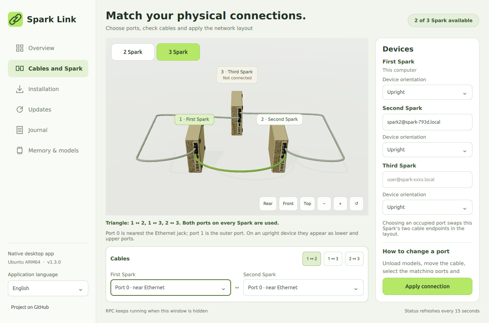

**English** | [Русский](triangle-and-detail-2026-10-31.ru.md)

# Spark Link 1.3: complete triangle and refined hardware

For three Sparks, the supported physical plan is a complete triangle: **1 ↔ 2, 1 ↔ 3 and 2 ↔ 3**, three cables total, using both QSFP ports on every device. A two-edge chain or duplicated physical port is rejected. The actual installation still contains two devices; three-device inference and onboarding must be qualified when the third Spark arrives.



| Cable | Default endpoints |
| --- | --- |
| First ↔ second | First port 0 ↔ second port 0 |
| First ↔ third | First port 1 ↔ third port 0 |
| Second ↔ third | Second port 1 ↔ third port 1 |

Port 0 is nearest Ethernet; port 1 is the outer QSFP. These are physical identities even when a case stands upright. Adding the third device preserves the first pair's existing port choices and uses their remaining ports. Choosing an occupied port exchanges the two endpoints **on that Spark in the draft**, keeping the triangle valid. It does not move a physical cable or reconfigure the running network. Unload models, move the cable, match the selectors and use **Apply connection** when changing real wiring.

The cable editor now shows three compact cable tabs and only the selected cable's two endpoint controls. The selected cable is highlighted in 3D. Longitudinal cable paths curve around cases; camera framing includes all three paths and resets appropriately for two or three devices. An offline third Spark has an explicit label. Four-language and compact-window rendering are checked.

Hardware refinements are original procedural artwork: subtle brushed lid material, rear legends, recessed QSFP contact rows, stamped cage rails, DAC latches, molded strain-relief ribs and underside fasteners. This is an illustration, not manufacturer CAD. Controls have consistent hover, pressed, disabled, selected and keyboard-focus states. Unchanged cable endpoints no longer rebuild their meshes during inventory refresh; no continuous scene animation was added.

## Install

On the first Spark:

```bash
curl -fsSL https://raw.githubusercontent.com/grosa787/connect-dual-spark-for-unsloth-studio/main/desktop/install-desktop.sh | bash
```

Or download `Spark-Link-1.3.0-arm64.run` and run:

```bash
bash "$HOME/Downloads/Spark-Link-1.3.0-arm64.run"
```

The installer adds the menu and desktop entries and includes the independent Qt runtime/management engine. [English instructions](../desktop/README.md).

## Verification and limits

- 138 CLI tests; 49 desktop tests across the isolated Qt runtime and Ubuntu system Python, including triangle degree/ports, invalid chain rejection, endpoint swaps, preserved pair expansion and cable/body clearance.
- Real ARM64 Qt: six tabs, four languages, triangle cable selection, automatic endpoint swap, mixed/upright placement, camera reset, 1240×820 and 1000×700 layouts, popup/keyboard controls and hide/show chassis rendering.
- The third device in previews is an **offline planning device**, not a third machine discovered during testing. No physical cable relocation, three-device inference or network reconfiguration was performed for this visual update.
- Model weights, contexts and the production llama.cpp/RPC settings are unchanged. The separate [generation study](design-and-generation-2026-10-31.md) remains experimental.

The actual 1.3.0 `.run` was installed on the primary Spark. The application menu, hidden startup, IPC reopen with visible chassis and independent Studio/RPC checks passed in Xvfb. Sample RSS was 422.1 / 425.2 / 425.2 MiB (hidden start / visible / hidden again), not a memory ceiling.
