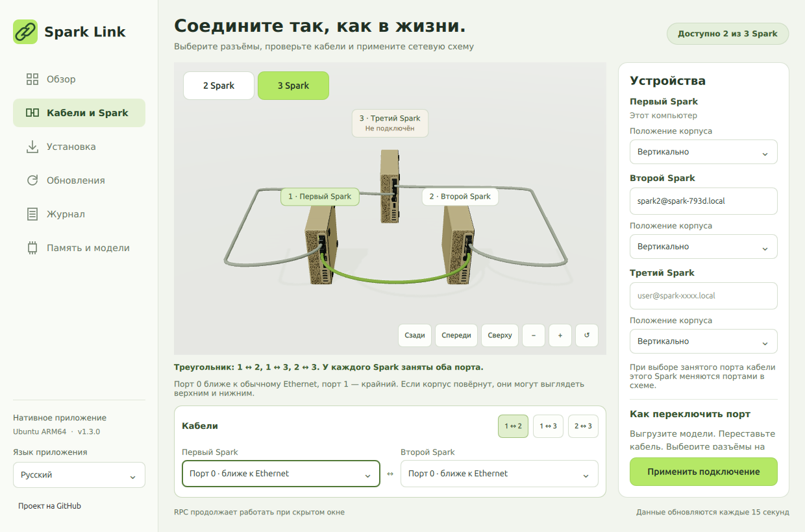

[English](triangle-and-detail-2026-10-31.md) | **Русский**

# Spark Link 1.3: полный треугольник и детализация корпусов

Для трёх Spark используется полный треугольник: **1 ↔ 2, 1 ↔ 3 и 2 ↔ 3**. Всего три кабеля, у каждого устройства используются оба QSFP-порта. Цепочка из двух кабелей и повторно занятый физический порт не проходят проверку. Сейчас в настоящем кластере остаются два устройства; работу вычислений и добавление третьего проверим после его подключения.



| Кабель | Разъёмы по умолчанию |
| --- | --- |
| Первый ↔ второй | Порт 0 первого ↔ порт 0 второго |
| Первый ↔ третий | Порт 1 первого ↔ порт 0 третьего |
| Второй ↔ третий | Порт 1 второго ↔ порт 1 третьего |

Порт 0 ближе к Ethernet, порт 1 — крайний QSFP. Номера остаются теми же при вертикальном положении корпуса. При добавлении третьего устройства сохраняются выбранные порты первой пары и используются оставшиеся свободные. Выбор занятого порта меняет местами два конца кабелей **на этом Spark в черновике**, сохраняя полный треугольник. Это не переставляет настоящий кабель и не изменяет работающую сеть. Для изменения проводов выгрузите модели, переставьте кабель, укажите разъёмы и нажмите **«Применить подключение»**.

В редакторе теперь три компактные кнопки кабелей и поля двух концов выбранного соединения. Выбранный кабель выделяется в 3D. Продольные трассы огибают корпуса; камера вмещает все три кабеля и правильно сбрасывается для двух или трёх устройств. У отсутствующего третьего Spark есть явная подпись. Проверяются четыре языка и компактное окно.

Добавлена собственная процедурная детализация: слабая фактура шлифованной крышки, надписи у разъёмов, утопленные контакты QSFP, направляющие металлических клеток, защёлки DAC, рёбра защиты кабеля от перегиба и крепёж снизу. Это иллюстрация, а не CAD производителя. У кнопок согласованы состояния наведения, нажатия, отключения, выбора и клавиатурного фокуса. Неизменённые концы кабелей больше не пересобирают сетки при обновлении данных; постоянная анимация сцены не добавлялась.

## Установка

На первом Spark:

```bash
curl -fsSL https://raw.githubusercontent.com/grosa787/connect-dual-spark-for-unsloth-studio/main/desktop/install-desktop.sh | bash
```

Либо скачайте `Spark-Link-1.3.0-arm64.run` и выполните:

```bash
bash "$HOME/Downloads/Spark-Link-1.3.0-arm64.run"
```

Установщик создаёт пункты меню и ярлык рабочего стола, включает независимый Qt и управляющий движок. [Инструкция на русском](../desktop/README.ru.md).

## Проверки и ограничения

- 138 тестов CLI; 49 тестов приложения в изолированном Qt и системном Python Ubuntu: полный треугольник, запрет цепочки, обмен портами, сохранение первой пары при расширении и отсутствие пересечений кабелей с корпусами.
- Настоящий Qt ARM64: шесть вкладок, четыре языка, выбор трёх кабелей, автоматический обмен концов, смешанное/вертикальное положение, сброс камеры, окна 1240×820 и 1000×700, списки, клавиатура и видимые корпуса после скрытия/открытия.
- Третье устройство на изображениях — **неподключённый узел планирования**, а не найденная во время проверки третья машина. Физические кабели, сеть и вычисления на трёх устройствах в этом обновлении не переключались.
- Веса моделей, контекст и рабочие настройки llama.cpp/RPC сохранены. Отдельное [исследование генерации](design-and-generation-2026-10-31.ru.md) остаётся экспериментальным.

Настоящий `.run` 1.3.0 установлен на первый Spark. В Xvfb проверены меню приложений, скрытый старт, открытие через IPC с видимыми корпусами и независимые Studio/RPC. Пример RSS: 422,1 / 425,2 / 425,2 МиБ (скрытый старт / открытое окно / снова скрыто), это не верхняя граница потребления.
